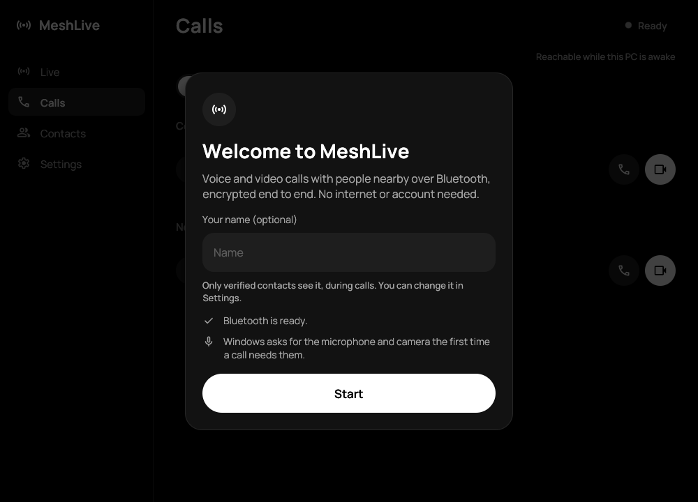
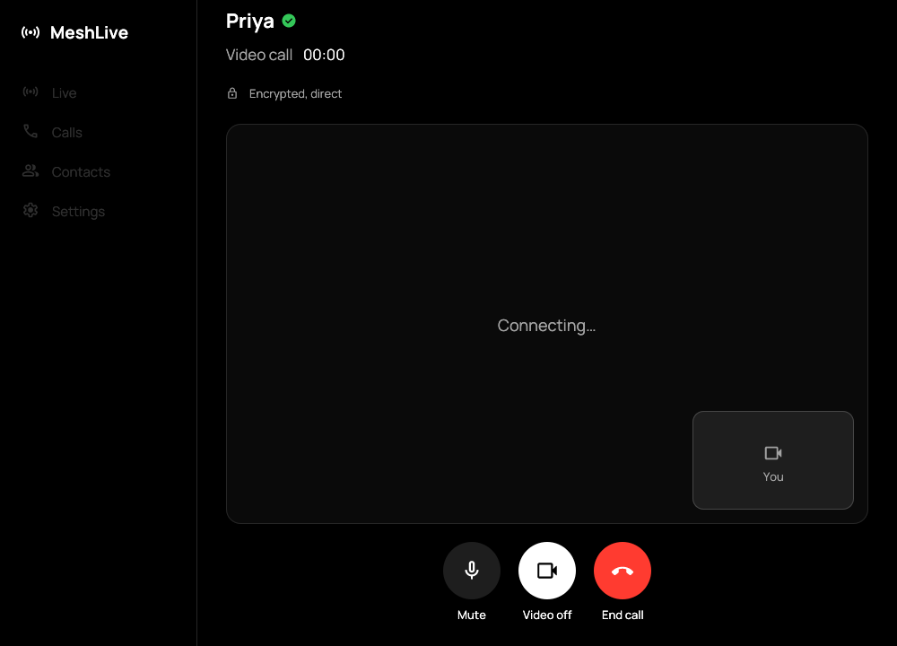

<div align="center">


# MeshLive for Windows

Encrypted voice and video calls between a Windows PC and phones nearby, over Bluetooth.<br/>
No internet, no SIM, no account.

<br/>

<p>
  
  
  
  <a href="https://github.com/MeshLive/meshlive-windows/actions/workflows/ci.yml"></a>
  <a href="https://github.com/MeshLive/meshlive-windows/stargazers"></a>
  <a href="https://scorecard.dev/viewer/?uri=github.com/MeshLive/meshlive-windows"></a>
</p>

<a href="docs/dev/building.md"></a>

<sub>Free · open source · beta · <a href="docs/user-guide.md">User guide</a> · <a href="docs/devices.md">Which PCs work</a></sub>

<br/>
<br/>




<sub>Offscreen renders of the app with sample data, made by the test suite (no real people or devices).</sub>

</div>

## What it does

MeshLive for Windows is the PC member of [MeshLive](https://github.com/MeshLive/meshlive-android): calls and live
streams between devices near each other, carried over Bluetooth Low Energy from device to device, with no internet,
phone network, account or server. It speaks the same wire protocol as the Android app, so a PC and a phone can call
each other directly.

<table>
<tr>
<td width="50%" valign="top">

**Calls (beta)**
- Voice and video calls with Android phones nearby, in both directions
- End-to-end encrypted, PC to phone
- Contacts added in person by scanning each other's code
- Missed calls, call back, block unknown callers

</td>
<td width="50%" valign="top">

**Your privacy**
- No internet, account, server, analytics or ads
- Strangers see a random ID that changes every 15 minutes
- Keys stay in Windows' protected key store and DPAPI-sealed files
- Delete everything from the PC in seconds

</td>
</tr>
</table>

**Live (beta, on by default since 0.2.1):** watching an Android phone's live stream or audio-only radio on the PC and
going live from the PC to one phone. On a PC that cannot do this, the Live tab says what is missing.
**Experimental, off by default:** outgoing calls through Android relay phones. See [Switches](docs/dev/switches.md).

## Status

MeshLive for Windows is **beta-quality**. Testers can download an unsigned zip from the
[releases page](https://github.com/MeshLive/meshlive-windows/releases/latest) (check it against `SHA256SUMS`; see the
[user guide](docs/user-guide.md#release-zip-testers)) or build it from source. There is no Microsoft Store listing or
code-signed download yet. It has not had an independent security audit: do not rely on it where your safety depends
on it.

What has been tried on real hardware (one Windows 11 x64 laptop with an Intel Bluetooth adapter, against Android
phones running the MeshLive Android app):

| Feature | Result so far |
| --- | --- |
| PC calls a phone (voice, video) | Worked: 90-second video calls to a contact, with every decoded frame shown on the phone in one daytime run (1,328 of 1,328); voice calls; calls to strangers through the Nearby list |
| Phone calls the PC (voice, video) | Worked from four phone models (6 of 6 video calls from one of them), including a stranger's phone and a phone without extended Bluetooth scanning, which finds the PC through the compact announcement |
| Call across a rotating-ID change | Worked: a 110-second video call across the 15-minute boundary, longest stall 0.2 s |
| Ringing, missed and blocked calls | Worked: no answer after 60 s ends as Missed call; blocked contacts and unknown callers are declined before ringing |
| Watch a phone's live stream (beta) | Worked in bounded runs: about 5 minutes of a phone camera stream (4,439 VP9 frames, pause, resume, end); about 5 minutes of signed audio-only radio, direct and through one Android relay phone. The first picture took 3.2 s, above the 3-second target |
| Go live from the PC (beta) | Worked in bounded runs to one phone: 5.5 minutes of audio-only radio; 2 minutes of PC camera video (1,256 frames rendered on the phone). A PC stream relayed onward by a phone did **not** pass, and occasional link stalls still end a stream |
| Packaged (MSIX) app | Not yet checked end to end; one packaged call dropped right after it was answered |

Not yet checked: Windows 10, ARM64 PCs, Bluetooth adapters other than the one above, sound quality and echo,
several viewers at once, and the on-air privacy checks for live streams. Calls with iPhones and Macs have not been
tested. The details and the open gates are in [testing](docs/dev/testing.md).

## Requirements

- **Windows 11, 64-bit (x64).** Receiving calls and the live-stream experiments need **Windows 11 version 24H2 or
  newer**. Windows 10 (version 2004 or newer) is a build target but has not been tested.
- **Bluetooth Low Energy.** Calling a phone has been tested with an Intel adapter; other adapters are not verified yet. **Receiving calls** needs an adapter that is on
  the [measured privacy allowlist](docs/devices.md#bluetooth-adapters) (today: Intel adapters), because Windows
  cannot show which address it advertises from. On other adapters the app says why and still calls out.
- A microphone and speakers or a headset; a camera for video calls and for scanning a contact's code.
- An Android phone with [MeshLive for Android](https://github.com/MeshLive/meshlive-android) within about 10 to 30 metres.

## Build from source

You need Windows 11 x64, the Rust toolchain (1.88 or newer, MSVC target), Visual Studio Build Tools with the C++
workload, the Windows SDK (for `fxc.exe`), Python 3 and Git for Windows. Then, from a Developer PowerShell:

```powershell
git clone https://github.com/MeshLive/meshlive-windows.git
cd meshlive-windows
powershell -NoProfile -ExecutionPolicy Bypass -File scripts\Build.ps1 -Action Test -Configuration Release
.artifacts\cargo\x86_64-pc-windows-msvc\release\meshlive.exe
```

`Build.ps1` downloads the pinned libopus, libaom and libvpx sources and build tools, checks their SHA-256 hashes,
builds them with a static CRT, then builds and tests the app. Details, packaging (MSIX and tester zip) and the
offline checks are in [building.md](docs/dev/building.md).

## Try it with an Android phone

1. Install [MeshLive for Android](https://github.com/MeshLive/meshlive-android/releases/latest) on a phone.
2. On the phone, turn on **Settings > Connection > Find iPhones** (it also finds Windows PCs).
3. Turn on Bluetooth on the PC and start `meshlive.exe`. **Calls > Nearby** lists the phone; press **Voice call** or
   **Video call**. To call the PC from the phone, keep MeshLive open on the PC with **Receive calls** on.

More in the [user guide](docs/user-guide.md); how to report what you saw is in [CONTRIBUTING.md](CONTRIBUTING.md).

## Privacy

No accounts, no ads, no analytics, no servers. Calls are encrypted end to end, and your name is only sent, encrypted,
to verified contacts. What nearby devices can and cannot see is explained in [Privacy](docs/privacy.md).

## Documentation

### For users

| Document | What it covers |
| --- | --- |
| [User guide](docs/user-guide.md) | Install, first run, calls, contacts, common problems, removing your data |
| [Privacy](docs/privacy.md) | What stays on the PC, what goes over Bluetooth, and the known limits |
| [Supported PCs](docs/devices.md) | Windows versions and Bluetooth adapters, what has been tested; report yours |

### For contributors

| Document | What it covers |
| --- | --- |
| [Contributing](CONTRIBUTING.md) | How to report a bug or a PC result and send a change |
| [Building](docs/dev/building.md) | Build, test and package from source |
| [Architecture](docs/dev/architecture.md) | How the app is built: modules, Bluetooth roles, media pipelines, storage |
| [Switches](docs/dev/switches.md) | The register of experimental, alternative and optional switches |
| [Testing](docs/dev/testing.md) | Unit tests, opt-in checks with your own phone, and the acceptance gates |
| [Video encoding](docs/dev/video-encoding.md) | Encoder choice, measured hardware and software encoders |
| [Design: watch and go live](docs/dev/design/watch-and-go-live.md) | How a PC joins Android live streams (design record) |
| [Store certification notes](packaging/CERTIFICATION.md) | Package capabilities and why each is needed |
| [Security](SECURITY.md) | Report a vulnerability privately |
| [Code of conduct](CODE_OF_CONDUCT.md) | How we treat each other |

The wire format and security rules are shared by every MeshLive app and live in
[meshlive-android's protocol reference](https://github.com/MeshLive/meshlive-android/blob/main/docs/dev/protocol/README.md).

## Other MeshLive apps

| Repository | What it is |
| --- | --- |
| [meshlive-android](https://github.com/MeshLive/meshlive-android) | The Android app; owns the protocol and the design records |
| [meshlive-apple](https://github.com/MeshLive/meshlive-apple) | iPhone and Mac app (early) |
| [meshlive-benchmarks](https://github.com/MeshLive/meshlive-benchmarks) | Measured results on real phones |
| [meshlive.github.io](https://meshlive.github.io) | Website and privacy policy |

## Contributing

Bug reports, PC and adapter results, and code are welcome. Start with [CONTRIBUTING.md](CONTRIBUTING.md), and please
follow the [code of conduct](CODE_OF_CONDUCT.md). Protocol changes start in
[meshlive-android](https://github.com/MeshLive/meshlive-android). Report security issues privately: see
[SECURITY.md](SECURITY.md).

## License

GPL-3.0-or-later, copyright The MeshLive Authors ([AUTHORS](AUTHORS)). See [LICENSE](LICENSE) and
[THIRD_PARTY_NOTICES.md](THIRD_PARTY_NOTICES.md).
